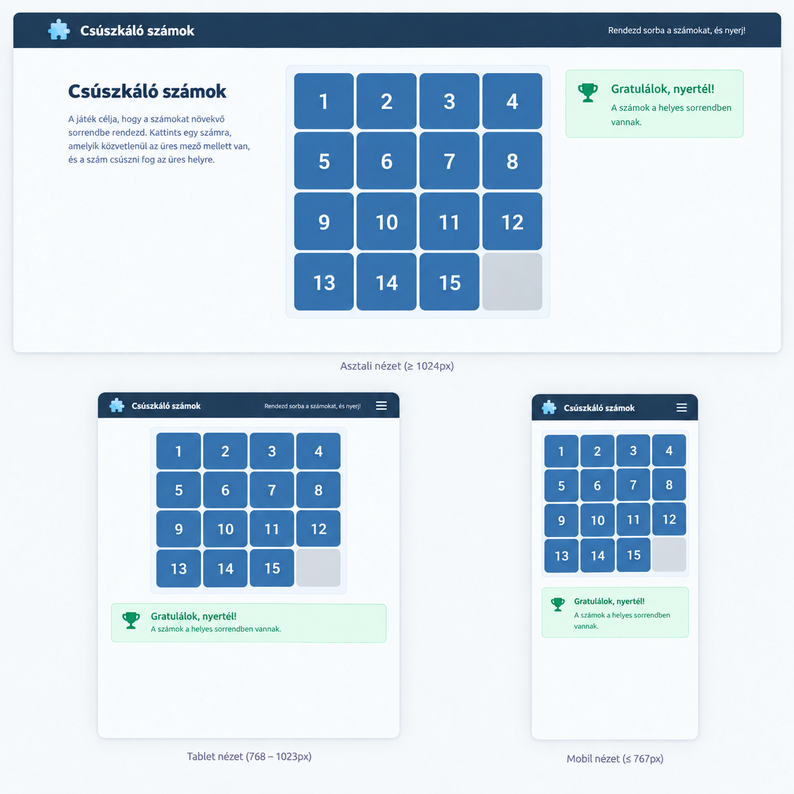

# Csúszkáló számok

A következő feladatban egy egyszerű logikai játékot kell elkészítened React segítségével.

A játékban egy 4×4-es négyzetrács jelenik meg, amelyben 15 számozott mező és egy üres mező található. A játékos a számokat az üres mezőbe csúsztathatja, amíg a számok növekvő sorrendbe nem kerülnek. A csúsztatást nem kell megvalósítani, egyszerűen csak a kattintott mező üres lesz, a szomszédos **üres** mező pedig megkapja az értéket. 

Első lépésben ne foglalkozz a keveréssel, használd ezt a listát: lista=[2,5,3,1,6,8,10,13,11,12,15,0,4,7,9,14]

A játék célja, hogy a játékos a számokat növekvő a sorrendbe rendezze.

A design színei és betűtípusai szabadon megválaszthatóak. Az oldal legyen áttekinthető, egységes és reszponzív.

## Az oldal működése

A játék indításakor jelenjen meg egy 4×4-es játéktábla, amely véletlenszerűen 1-15-ig tartalamaz számokat és egy üres mezőt. A játékos a mezőkre kattintva mozgathatja a számokat. Egy számot csak akkor lehessen elmozdítani, ha közvetlenül az üres mező mellett helyezkedik el vízszintesen vagy függőlegesen.

Ha a játékos egy mozgatható számra kattint, a szám és az üres mező cseréljen helyet. 

## Szükséges komponensek

1. App - itt kezeljük a  program állapotát. (vagy a contextben)
2. Jatekter - itt jelenik meg a 16 gomb.
3. Gomb - egy gomb, amire kattintani lehet. 

## A program állapotát leíró változók

lista - itt tároljuk a számokat

# Ötletek

## Keverés megvalósítása

- Ha marad időd, hozz létre egy keveres metodust, mely feltölti a listát 0-15-ig számokkal, majd mondjuk  10x véletlenszerűen kiválaszt  két indexet és megcseréli azok tartalmát. 
- Használhatod a sort() függvényt is a lista véletlen keveréséhez.  lista.sort(()=>{});

# Extrák

## A játék működésének ellenőrzése

1. A játék figyelje, hogy a számok a megfelelő sorrendben állnak-e.
1. Ha a játékos kirakja a helyes sorrendet, jelenjen meg egy jól látható „Gratulálok, nyertél!” üzenet.
1. A győzelem után a játék ne engedje a mezők további mozgatását.

## Új játék

Az oldalon legyen egy „Új játék” gomb.

A gombra kattintva a játékmezők keveredjenek össze, és a játékos újra elkezdhesse a feladatot. Az esetek felében a játék nem megoldható!

